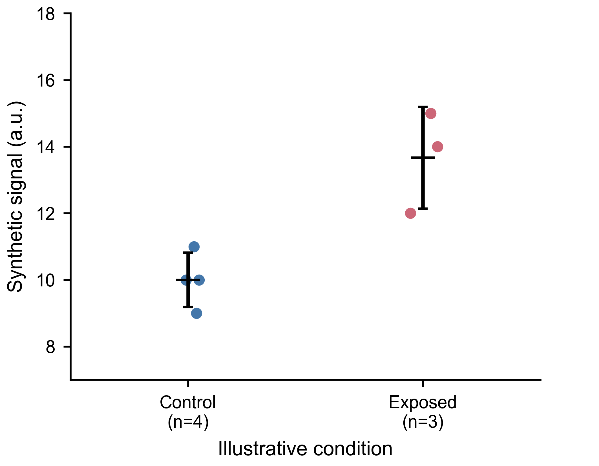

# Top-Journal Scientific Figures · 顶刊科研图表美学与生成

从原始数据到可追溯、可复现、清晰且有审美的科研 figure。面向论文、基金申请、学术汇报，以及投稿前图件生成、修改和审查。

这个 Codex skill 将科研数据处理规则、克制的视觉设计、可编辑矢量导出和审查流程结合起来。参考 Nature、Science、Cell、The Lancet、NEJM、PNAS、JACS、Angewandte Chemie 和 Advanced Materials 等期刊的视觉语言，同时区分通用审美建议与需要按期刊、文章类型和投稿阶段核实的要求。

**不编造数据、p 值、样本量、误差区间或图像标尺。** 自动识别仅提出候选数据类型；实验单位、配对关系、技术重复和统计方法仍需科学依据。

## 能做什么

- **生成与润色科研图**：点图、误差图、剂量/时间曲线、多 panel、组学图、光谱、材料性能图及模型评估图的设计与代码辅助。
- **数据可追溯**：保存原始文件、SHA-256、有效 n、缺失行、变换和配置，每张图附审计记录。
- **批量统一**：提供可执行 CSV 批量流程，统一组别顺序、颜色、尺寸以及经过科学确认的共同尺度。
- **防止误分析**：检查重复实验单位、错误独立性、未确认的实验层级、非法对数变换，以及隐藏数据或误差条的坐标范围。
- **导出与审查**：输出 SVG/PDF/PNG，可选 TIFF；检查实际像素尺寸、DPI、文字越界、候选文字重叠和 SVG 可编辑文本。
- **复现**：结果附原始数据快照、确切版本的绘图代码、配置和图注草稿。

内置 CSV 流程专注独立或配对的“原始点 + 均值/样本 SD”。其他图型通过 skill 指引和原有领域示例代码实现；不宣称一个命令自动完成所有统计分析。

## 示例

<!-- Update image paths to the nested package layout when publishing. -->


此图仅使用合成示例数据，不能作为真实科研证据。Control 有效 n=4，Exposed 有效 n=3；缺失值被明确记录。

## 安装与调用

将仓库内含 `SKILL.md` 的 `top-journal-scientific-figures` 文件夹复制到个人 Codex skills 目录，例如：

```sh
git clone https://github.com/leoche2021-ui/top-journal-scientific-figures.git
cp -R top-journal-scientific-figures/top-journal-scientific-figures ~/.codex/skills/
```

在 Codex 中调用：

```text
使用 $top-journal-scientific-figures 检查这些原始数据，确认实验单位和单位后，
生成论文用 figure。保留原始点，统一所有图的颜色与组别顺序，
导出 SVG/PDF/PNG，并交付代码、数据审计和视觉审查结果。
```

## 运行批量示例

```sh
cd top-journal-scientific-figures
python3 -m pip install -r requirements.txt
python3 scripts/figure_pipeline.py examples/batch.json
```

输出目录由配置指定。为避免误覆盖，已有输出目录会导致停止；重跑请使用新目录。每个成功结果目录内可按 `reproduce.txt` 复现。

- [配置说明](top-journal-scientific-figures/references/batch_schema.md)
- [数据与统计边界](top-journal-scientific-figures/references/data_statistics.md)
- [期刊来源与核查状态](top-journal-scientific-figures/references/journal_profiles.md)
- [视觉 QA](top-journal-scientific-figures/references/visual_qa.md)
- [验证记录](top-journal-scientific-figures/references/validation_record.md)

## 代码与资源

| 文件 | 用途 |
| --- | --- |
| `SKILL.md` | Codex 工作流和使用边界 |
| `scripts/journal_style.py` | 原有绘图辅助函数的改进版，新增点图及配对支持 |
| `scripts/figure_pipeline.py` | 数据审计、批量绘图、导出检查与复现 |
| `scripts/accessibility_preview.py` | 可选色觉模拟，需要额外安装 Colorspacious |
| `scripts/original/` | 升级前的原始脚本与 skill 文本 |
| `examples/` | 领域示例、合成数据、配置及已验证输出 |
| `tests/test_pipeline.py` | 数据完整性和复现行为测试 |

上述路径相对于技能包目录。

## 验证与限制

8 项行为测试和批量失败隔离检查通过，主流程生成的最终图已目视检查。运行测试：

```sh
python3 -m unittest discover -s tests -v
```

自动 QA 是辅助审查：它不能证明实验有效、统计结论正确或完全符合投稿要求。PDF 字体嵌入尚未独立实测；可选色觉模拟在本次验证环境中缺少依赖，尚未运行。期刊来源的核查状态逐项记录，实际投稿前需要复核现行要求。XLSX/TSV、技术重复聚合及复杂统计分析需显式预处理并保留代码和记录。

## English

A Codex skill and Python toolkit for trustworthy, restrained publication figures. It combines raw-data provenance, explicit experimental-unit semantics, configurable batch styling, editable vector exports, and partial automated visual QA. The executable CSV pipeline supports independent or paired point plots with descriptive mean/sample SD; broader figure types are guided by domain references and example code. It never fabricates measurements or statistical evidence and does not certify journal compliance.
